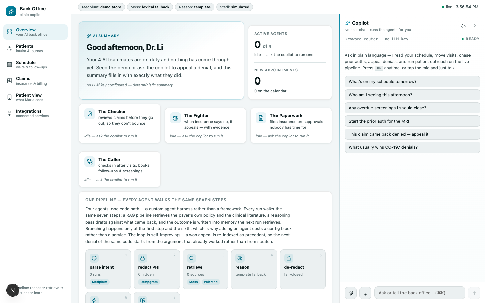

# The Autonomous Back Office

Four AI agents that run a clinic's insurance and follow-up work, triggered by events in a FHIR
record. Built in 24 hours at the YC x Medplum Hackathon (YC SF, Aug 1 2026) by Rishabh Sahoo and
Amresh Balakrishnan.



## The problem

A small clinic loses hours every day to paperwork nobody went to medical school for: claims that
bounce for a missing field, denials that never get appealed, prior authorizations, and follow-up
calls after a visit. This project hands that work to agents that react to the clinic's own records
and leave a full audit trail behind.

## The agents

| Agent | Fires when | What it does |
|-------|------------|--------------|
| The Checker (claim triage) | A `Claim` is ready to submit | Checks it against the payer's criteria and fixes gaps before it goes out |
| The Fighter (denial appeal) | A `ClaimResponse` comes back denied | Pulls the payer policy and real PubMed evidence, drafts an appeal, waits for a human to approve, then sends it |
| The Paperwork (prior auth) | A `ServiceRequest` needs authorization | Assembles the missing documentation and files it |
| The Caller (discharge + care gaps) | An `Encounter` finishes | Checks in after the visit, books the follow-up, and closes overdue screenings |

## How it works

All four agents run through one pipeline. Only the first step (which agent?) and the dispatch step
differ, so adding an agent means adding a config, not a service.

```
FHIR event -> parse intent -> retrieve -> reason -> write outcome -> learn
               (which agent)  (payer     (tool-     (Task, Comm-     (memory +
                              policy,    using      unication,       re-index
                              PubMed)    Claude)    AuditEvent)      playbook)
```

- **Medplum is the database and the event bus.** FHIR Subscriptions fire the webhook; every run
  writes back a `Task`, a `Communication`, and an `AuditEvent`. Repeated events are ignored by
  looking up the `Task` for that resource.
- **The reasoning step is a tool-using agent** with FHIR read/write, Moss semantic search, PubMed,
  its own run memory, and Stedi EDI tools (eligibility 270/271, claims 837, attachments 275, prior
  auth 278). A citation check removes any PubMed ID the agent didn't actually retrieve.
- **It learns from outcomes.** When an appeal wins, the winning argument is saved as a playbook
  entry and re-indexed into Moss, so the next denial with the same code starts from what worked.
- **Humans stay in control.** Appeal drafts wait in an approval queue instead of going straight
  to the payer.
- **A clinic copilot** (chat and voice) lets staff run any agent in plain language, move
  appointments, check coverage, and order scans. With a Vapi key it also answers a real phone line,
  with Deepgram for speech and the copilot as the brain.
- **PHI redaction.** Patient details are swapped for typed tokens and restored afterwards, failing
  closed on any unknown token. The dashboard shows how many tokens were hidden.

## Run it

Needs Node 20+. No API keys required: every integration falls back to a local version.

```bash
cd app
npm install
npm run seed          # demo patients and claims
npm run dev           # http://localhost:3000
npm run demo -- deny  # in another terminal: fire a denial and watch the appeal agent
```

Other scenarios: `npm run demo -- approve | triage | discharge | prior-auth`.

| Service | With a key | Without one |
|---------|-----------|-------------|
| Medplum | Hosted FHIR + Subscriptions (`npm run subscriptions`) | File-backed store in `app/.data/` |
| Anthropic / OpenRouter | Tool-using Claude agent, copilot model picker | Deterministic template output |
| Moss | Semantic search over payer criteria and playbooks | Keyword search over the same corpus |
| Stedi | Real eligibility checks in test mode | Simulated, labeled acknowledgements |
| Vapi + Deepgram | A live clinic phone line | Text copilot only |

Copy `app/.env.example` to `app/.env` to turn any of them on.

## Honest notes

- **All patient data is synthetic** (Synthea plus hand-written demo records). No real PHI was
  ever used.
- **Denials are simulated.** Stedi's test mode always pays every claim, so a deterministic
  simulator produces the denial, and a simulated payer approves an appeal about 45 seconds later.
  The rest of the pipeline treats these as real `ClaimResponse` resources.
- It's a hackathon build: there's no test suite, and the phone line needs a public tunnel URL.

## Stack

TypeScript, Next.js 15 (App Router), React 19, Medplum (FHIR R4), Anthropic SDK, Moss, Stedi,
PubMed E-utilities, Vapi, Deepgram.

`docs/system-architecture.md` and `AGENTS.md` are the original hackathon plan. Where they
disagree with this README (five agents, Twilio calling), the code and this README are current.
