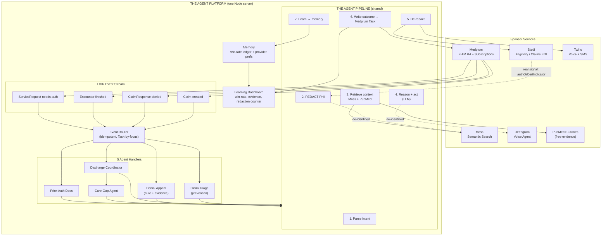
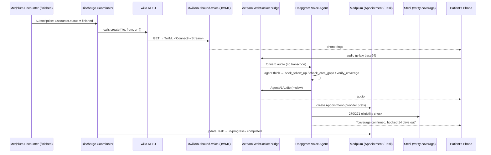
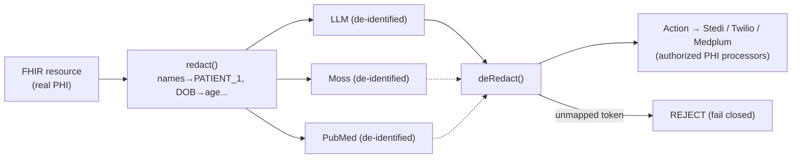

# System Architecture — "The Autonomous Back Office"

> Rendered on GitHub as Mermaid. This matches `AGENTS.md` §§2–5.8.

## High-level system



## Outbound call path (discharge + care-gap)



## Privacy / redaction data flow



## Full text diagram (plain text fallback)

```
┌──────────────────────────────────────────────────────────────────────┐
│                        SPONSOR SERVICES                              │
│  Medplum(FHIR)  Stedi(EDI)  Moss(search)  Deepgram(voice)  Twilio    │
│  PubMed E-utilities(free evidence)                                  │
└──────────────────────────────────────────────────────────────────────┘
                          │ Medplum Subscriptions (event stream)
                          │
      ┌───────────────────┼──────────────────┬────────────────┐
      ▼                   ▼                  ▼                ▼
  Claim created      ClaimResponse      Encounter        ServiceRequest
      │                denied            finished       needs prior auth
      ▼                   ▼                  ▼                ▼
  ┌────────┐       ┌──────────┐     ┌────────────────┐  ┌─────────────┐
  │ Claim  │       │ Denial   │     │ Discharge Coord│  │ Prior-Auth  │
  │ Triage │       │ Appeal   │     │ + Care-Gap     │  │ Docs Agent  │
  └────┬───┘       └────┬─────┘     └────────┬───────┘  └──────┬──────┘
       │                │                    │                 │
       │      ┌─────────▼────────────────────▼─────────────────▼──────┐
       └─────▶│  THE AGENT PIPELINE (shared)                         │
              │  1. Parse intent        ← FHIR event                 │
              │  2. REDACT PHI          ← de-identify before outbound│
              │  3. Retrieve criteria   ← Moss + PubMed evidence     │
              │  4. Reason + act        ← LLM → Stedi / Twilio       │
              │  5. De-redact           ← re-inject PHI              │
              │  6. Write outcome       → Medplum Task               │
              │  7. Learn               → memory ledger               │
              └───────┬──────────────────────────────────────────────┘
                      │
                      ▼
   ┌──────────────────────────────────────────────┐
   │ Learning dashboard: win rate by denial        │
   │ reason, gaps closed, evidence + PHI counter   │
   └──────────────────────────────────────────────┘
```
